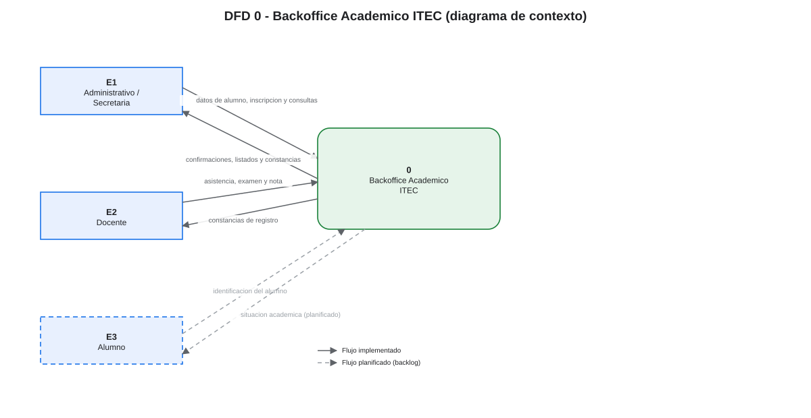

# 05 — DFD 0: diagrama de contexto

## 1. Propósito

Mostrar el sistema como **un único proceso** y las entidades externas con las que intercambia datos. No se muestran almacenes internos ni descomposición de procesos.

## 2. Diagrama

> Fuente editable: [`diagramas/dfd-0.drawio`](diagramas/dfd-0.drawio). Notación Gane-Sarson.

## 3. Notación

| Símbolo | Elemento |
|---|---|
| Rectángulo | Entidad externa |
| Rectángulo con esquinas redondeadas | Proceso |
| Flecha etiquetada | Flujo de datos |
| Línea discontinua | Flujo planificado (backlog) |

## 4. Entidades externas

| ID | Entidad | Descripción | Estado |
|---|---|---|---|
| E1 | Administrativo / Secretaría | Registra alumnos e inscripciones y consulta información académica | Implementado |
| E2 | Docente | Registra asistencias, exámenes y notas | Implementado (mismo menú que E1) |
| E3 | Alumno | Consulta su situación académica | Planificado |

## 5. Flujos del contexto

| ID | Origen | Destino | Flujo | Contenido | Estado |
|---|---|---|---|---|---|
| F01 | E1 | 0 | Datos de alumno, inscripción y consultas | Nombre, apellido, DNI, email, teléfono, comisión elegida, criterios de búsqueda | ✅ |
| F02 | 0 | E1 | Confirmaciones, listados y constancias | Alumno registrado, inscripción, listados, reportes | ✅ |
| F03 | E2 | 0 | Asistencia, examen y nota | Documento, presencia, datos del examen, valor de nota, observación | ✅ |
| F04 | 0 | E2 | Constancias de registro | Asistencia, examen y nota registrados | ✅ |
| F05 | E3 | 0 | Identificación del alumno | DNI del alumno | 📋 |
| F06 | 0 | E3 | Situación académica | Notas, asistencias y estado de cursada | 📋 |

## 6. Narrativa

1. **E1 (Administrativo)** envía al sistema los datos necesarios para dar de alta alumnos y para consultar la estructura académica. El sistema responde con confirmaciones, listados y constancias.
2. **E2 (Docente)** informa asistencias, exámenes y notas de las comisiones. El sistema confirma cada registro.
3. **E3 (Alumno)** es un actor previsto para una consulta de autoservicio. Hoy no existe el módulo, por eso sus flujos se dibujan discontinuos y se marcan como planificados.

## 7. Balanceo con el DFD 1

Los flujos de este nivel se descomponen en el [DFD 1](06-dfd-1-sistema.md) de la siguiente manera:

| Flujo DFD 0 | Se descompone en |
|---|---|
| F01 | F01 (E1→1.0), F03 (E1→2.0), F05 (E1→6.0) |
| F02 | F02 (1.0→E1), F04 (2.0→E1), F06 (6.0→E1) |
| F03 | F07 (E2→3.0), F09 (E2→4.0), F11 (E2→5.0) |
| F04 | F08 (3.0→E2), F10 (4.0→E2), F12 (5.0→E2) |
| F05 | F13 (E3→7.0) |
| F06 | F14 (7.0→E3) |

No hay flujos entre entidades externas ni entre el proceso y almacenes en este nivel.

## 8. Relación con las historias

| Entidad | Historias |
|---|---|
| E1 | HU-01 a HU-05, HU-18 a HU-24 |
| E2 | HU-06 a HU-17 |
| E3 | HU-28 (backlog) |

Ver también [08 — Trazabilidad](08-trazabilidad.md).
