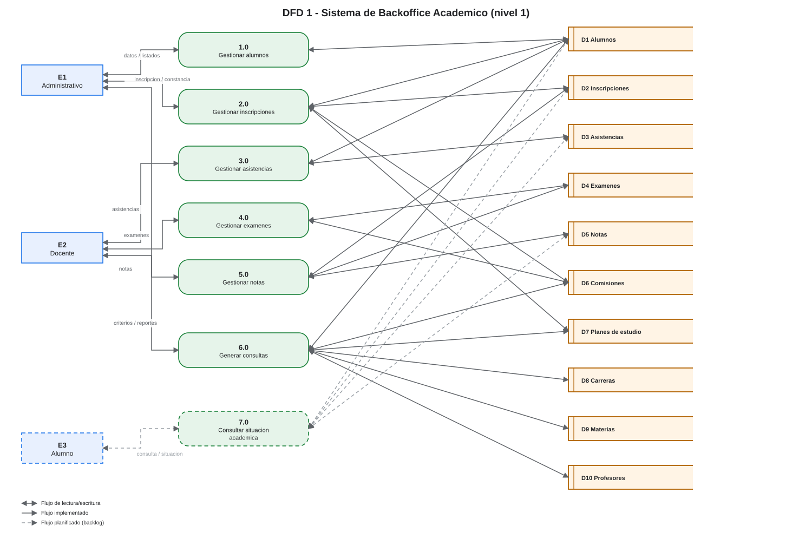

# 06 — DFD 1: descomposición del sistema

## 1. Propósito

Descomponer el proceso `0` del [DFD 0](05-dfd-0-contexto.md) en los procesos principales, los almacenes lógicos y los flujos internos.

## 2. Diagrama

> Fuente editable: [`diagramas/dfd-1.drawio`](diagramas/dfd-1.drawio).

## 3. Convenciones del diagrama

- Los procesos se numeran `1.0`, `2.0`, … y usan verbo + sustantivo.
- Los almacenes se identifican `D1` a `D10`.
- La **flecha de doble punta** indica lectura y escritura sobre un almacén, o intercambio de entrada/salida con una entidad. Es una simplificación para no duplicar cada flujo; el detalle de qué se lee y qué se escribe está en las tablas de este documento.
- La línea **discontinua** corresponde al proceso `7.0` y al actor E3, planificados en el backlog.

## 4. Procesos

| Proceso | Nombre | Actor | Entradas | Salidas | Almacenes | HU |
|---|---|---|---|---|---|---|
| 1.0 | Gestionar alumnos | E1 | Datos del alumno, criterio de búsqueda | Alumno registrado, listado | D1 | HU-01 a HU-03 |
| 2.0 | Gestionar inscripciones | E1 | DNI y comisión elegida de la lista | Constancia de inscripción | D1, D2, D6, D7 | HU-04, HU-05 |
| 3.0 | Gestionar asistencias | E2 | Documento, presencia, fecha | Asistencia registrada | D1, D3 | HU-10 a HU-13 |
| 4.0 | Gestionar exámenes | E2 | Comisión, nombre, descripción, fecha, tipo | Examen registrado | D4, D6 | HU-06 a HU-09 |
| 5.0 | Gestionar notas | E2 | Inscripción, examen, valor, observación | Nota registrada | D2, D4, D5 | HU-14 a HU-17 |
| 6.0 | Generar consultas | E1 | Criterio de consulta | Listados y reportes | D1, D6, D7, D8, D9, D10 | HU-18 a HU-24 |
| 7.0 | Consultar situación académica | E3 | Identificación del alumno | Notas, asistencias, estado | D1, D2, D3, D5 | HU-28 📋 |

## 5. Almacenes lógicos

| ID | Almacén | Contenido | Implementación actual |
|---|---|---|---|
| D1 | Alumnos | Datos personales del alumno | `AlumnoRepository` (en memoria) |
| D2 | Inscripciones | Relación alumno–comisión, fecha, asistencias y notas | `AlumnoRepository.inscripcionesComision` (`AlumnoInscripto`) |
| D3 | Asistencias | Documento, fecha, presente | `AsistenciaRepository` (`AsistenciaAlumno`) |
| D4 | Exámenes | Comisión, nombre, descripción, fecha, tipo | `ExamenRepository` |
| D5 | Notas | Examen, valor, observación, fecha de registro | `NotaRepository` |
| D6 | Comisiones | Código, materia, profesor, cuatrimestre, horarios | `ComisionRepository` |
| D7 | Planes de estudio | Carrera, año y materia | `PlanEstudioRepository` |
| D8 | Carreras | Código y nombre | `CarreraRepository` |
| D9 | Materias | Nombre | `MateriaRepository` |
| D10 | Profesores | Nombre, apellido, email, teléfono | `ProfesorRepository` |

> Todos los almacenes son **lógicos**: no hay base de datos. Los repositorios se cargan al iniciar y se pierden al cerrar la aplicación. Ver [RNF-01](02-reglas-negocio.md#2-requisitos-no-funcionales).

## 6. Flujos

### 6.1 Flujos con entidades externas

| ID | Origen | Destino | Flujo | Estado |
|---|---|---|---|---|
| F01 | E1 | 1.0 | Datos de alumno | ✅ |
| F02 | 1.0 | E1 | Confirmación y listado de alumnos | ✅ |
| F03 | E1 | 2.0 | DNI y comisión seleccionada para inscripción | ✅ |
| F04 | 2.0 | E1 | Constancia de inscripción | ✅ |
| F05 | E1 | 6.0 | Criterio de consulta | ✅ |
| F06 | 6.0 | E1 | Listados y reportes | ✅ |
| F07 | E2 | 3.0 | Documento, presencia y fecha | ✅ |
| F08 | 3.0 | E2 | Constancia de asistencia | ✅ |
| F09 | E2 | 4.0 | Datos del examen (incluida la descripción) | ✅ |
| F10 | 4.0 | E2 | Constancia de examen | ✅ |
| F11 | E2 | 5.0 | Datos de la nota (alumno inscripto, examen, valor, observación) | ✅ |
| F12 | 5.0 | E2 | Constancia de nota | ✅ |
| F13 | E3 | 7.0 | Identificación del alumno | 📋 |
| F14 | 7.0 | E3 | Situación académica | 📋 |

### 6.2 Flujos proceso ↔ almacén

| Proceso | Almacén | Operación |
|---|---|---|
| 1.0 | D1 | Alta, búsqueda y listado de alumnos |
| 2.0 | D1 | Lectura del alumno por DNI |
| 2.0 | D2 | Alta y consulta de inscripciones |
| 2.0 | D6 | Lectura de la comisión |
| 2.0 | D7 | Lectura del plan de estudio |
| 3.0 | D1 | Validación del alumno |
| 3.0 | D3 | Alta, lectura, modificación y baja de asistencias |
| 4.0 | D4 | Alta, lectura, modificación y baja de exámenes |
| 4.0 | D6 | Lectura de la comisión |
| 5.0 | D2 | Lectura de la inscripción del alumno |
| 5.0 | D4 | Lectura del examen |
| 5.0 | D5 | Alta, lectura, modificación y baja de notas |
| 6.0 | D1 | Listado de alumnos |
| 6.0 | D6 | Listado de comisiones y comisiones por profesor |
| 6.0 | D7 | Planes de estudio |
| 6.0 | D8 | Carreras |
| 6.0 | D9 | Materias |
| 6.0 | D10 | Profesores |
| 7.0 | D1, D2, D3, D5 | Lectura de la situación del alumno (planificado) |

## 7. Balanceo

| Flujo del DFD 0 | Flujos del DFD 1 |
|---|---|
| F01 Datos de alumno, inscripción y consultas | F01, F03, F05 |
| F02 Confirmaciones, listados y constancias | F02, F04, F06 |
| F03 Asistencia, examen y nota | F07, F09, F11 |
| F04 Constancias de registro | F08, F10, F12 |
| F05 Identificación del alumno | F13 |
| F06 Situación académica | F14 |

El balanceo se cumple: no aparecen ni desaparecen flujos entre niveles.

## 8. Correspondencia con el código

| Proceso | Controlador | Servicio | Repositorio |
|---|---|---|---|
| 1.0 | `AlumnoController` | `AlumnoService` | `AlumnoRepository` |
| 2.0 | `AlumnoController` | `AlumnoService` | `AlumnoRepository`, `ComisionRepository`, `PlanEstudioRepository` |
| 3.0 | `AsistenciaController` | `AsistenciaService` | `AsistenciaRepository` |
| 4.0 | `ExamenController` | `ExamenService` | `ExamenRepository` |
| 5.0 | `NotaController` | `NotaService` | `NotaRepository` |
| 6.0 | — (vistas de consulta) | — | `CarreraRepository`, `MateriaRepository`, `ProfesorRepository`, `PlanEstudioRepository`, `ComisionRepository`, `AlumnoRepository` |
| 7.0 | — | — | — (planificado) |

## 9. Observaciones de análisis

1. **2.0 lee la comisión real**: el controlador resuelve la comisión con `ComisionRepository.buscarPorCodigo`, de modo que la inscripción en D2 conserva profesor, cuatrimestre y horarios de D6.
2. **5.0 no registra el alumno en D5**: la nota se guarda con el examen, pero la relación con el alumno queda solo en D2 (`AlumnoInscripto`). Esto impide reconstruir la nota por alumno al listar.
3. **4.0 registra la descripción**: la vista solicita ese dato y lo envía al servicio; F09 se completa y D4 se escribe desde el menú, lo que habilita la selección de examen en 5.0.
4. **7.0** es el único proceso planificado; se incluye para reflejar el actor E3 y la HU-28.

Ver [07 — Diccionario de datos](07-diccionario-datos.md).
