# 09 — Modelo de dominio

## 1. Diagrama de clases

```mermaid
classDiagram
    class Alumno {
        -String nombre
        -String apellido
        -String dni
        -String email
        -String telefono
        +getNombreCompleto() String
        +equals(Object) boolean
        +hashCode() int
    }

    class AlumnoInscripto {
        -Alumno alumno
        -ComisionMateria comision
        -LocalDate fechaInscripcion
        -List~Asistencia~ asistencias
        -List~Nota~ notas
        +registrarAsistencia(Asistencia) void
        +calcularPorcentajeAsistencia() double
        +esRegular(double) boolean
        +agregarNota(Nota) void
    }

    class ComisionMateria {
        -String codigo
        -Materia materia
        -Profesor profesor
        -Cuatrimestre cuatrimestre
        -List~HorarioClase~ horarios
        +agregarHorario(HorarioClase) void
        +chocaCon(ComisionMateria) boolean
    }

    class Materia {
        -String nombre
    }

    class Carrera {
        -String codigo
        -String nombre
    }

    class PlanEstudio {
        -Carrera carrera
        -int anio
        -Materia materia
    }

    class Profesor {
        -String nombre
        -String apellido
        -String email
        -String telefono
        +getNombreCompleto() String
    }

    class Cuatrimestre {
        -int anio
        -int numero
        -LocalDate fechaInicio
        -LocalDate fechaFin
    }

    class HorarioClase {
        -DayOfWeek diaSemana
        -List~ModuloHorario~ modulos
        +agregarModulo(ModuloHorario) void
        +chocaCon(HorarioClase) boolean
        +duracionTotalEnMinutos() long
    }

    class ModuloHorario {
        -int numero
        -LocalTime horaInicio
        -LocalTime horaFin
        +seSuperponeCon(ModuloHorario) boolean
        +duracionEnMinutos() long
    }

    class Asistencia {
        -LocalDate fecha
        -boolean presente
        +esMismaFecha(Asistencia) boolean
    }

    class AsistenciaAlumno {
        -Long id
        -String documentoAlumno
        -LocalDate fecha
        -boolean presente
    }

    class Examen {
        -Long id
        -ComisionMateria comision
        -String nombre
        -String descripcion
        -LocalDate fecha
        -TipoEvaluacion tipoEvaluacion
    }

    class Nota {
        -Long id
        -Examen examen
        -Double valor
        -String observacion
        -LocalDate fechaRegistro
    }

    class TipoEvaluacion {
        <<enumeration>>
        PARCIAL
        RECUPERATORIO
        FINAL
    }

    class EstadoCursada {
        <<enumeration>>
        PROMOCIONADO
        REGULAR
        DESAPROBADO
    }

    AlumnoInscripto "1..*" --> "1" Alumno : alumno
    AlumnoInscripto "*" --> "1" ComisionMateria : comision
    AlumnoInscripto "1" o-- "*" Asistencia : asistencias
    AlumnoInscripto "1" o-- "*" Nota : notas

    ComisionMateria "*" --> "1" Materia : materia
    ComisionMateria "*" --> "0..1" Profesor : profesor
    ComisionMateria "*" --> "0..1" Cuatrimestre : cuatrimestre
    ComisionMateria "1" o-- "*" HorarioClase : horarios

    HorarioClase "1" o-- "*" ModuloHorario : modulos

    PlanEstudio "*" --> "1" Carrera : carrera
    PlanEstudio "*" --> "0..1" Materia : materia

    Examen "*" --> "1" ComisionMateria : comision
    Examen "*" --> "1" TipoEvaluacion : tipoEvaluacion
    Nota "*" --> "1" Examen : examen
```

## 2. Relaciones principales

| Relación | Multiplicidad | Cardinalidad real | Observación |
|---|---|---|---|
| AlumnoInscripto → Alumno | 1..* a 1 | Un alumno puede tener varias inscripciones | — |
| AlumnoInscripto → ComisionMateria | * a 1 | Una comisión puede tener varios inscriptos | — |
| AlumnoInscripto → Asistencia | 1 a * | Asistencias por inscripción | Objeto de valor, no registro de repositorio |
| AlumnoInscripto → Nota | 1 a * | Notas por inscripción | Asociación solo en memoria |
| ComisionMateria → Materia | * a 1 | — | — |
| ComisionMateria → Profesor | * a 0..1 | Puede no tener profesor | — |
| ComisionMateria → Cuatrimestre | * a 0..1 | Puede no tener cuatrimestre | — |
| ComisionMateria → HorarioClase | 1 a * | — | — |
| HorarioClase → ModuloHorario | 1 a * | — | — |
| PlanEstudio → Carrera | * a 1 | — | — |
| PlanEstudio → Materia | * a 0..1 | — | — |
| Examen → ComisionMateria | * a 1 | — | — |
| Nota → Examen | * a 1 | — | — |

## 3. Entidades y repositorios

| Entidad | Repositorio | Persistencia |
|---|---|---|
| Alumno | `AlumnoRepository` | Memoria |
| AlumnoInscripto | `AlumnoRepository` (lista de inscripciones) | Memoria |
| AsistenciaAlumno | `AsistenciaRepository` | Memoria |
| Examen | `ExamenRepository` | Memoria |
| Nota | `NotaRepository` | Memoria |
| ComisionMateria | `ComisionRepository` | Memoria con datos semilla |
| PlanEstudio | `PlanEstudioRepository` | Memoria con datos semilla |
| Carrera | `CarreraRepository` | Memoria con datos semilla |
| Materia | `MateriaRepository` | Memoria con datos semilla |
| Profesor | `ProfesorRepository` | Memoria con datos semilla |

## 4. Decisiones y limitaciones del modelo

1. **Dos representaciones de asistencia:**
   - `Asistencia` (fecha + presente) se usa dentro de `AlumnoInscripto` y permite calcular porcentaje y regularidad.
   - `AsistenciaAlumno` (id + documento + fecha + presente) es la que persiste el repositorio y usa el menú.
   - No están sincronizadas: registrar una `AsistenciaAlumno` no agrega una `Asistencia` a la inscripción.

2. **Nota sin alumno:** `Nota` referencia al examen, no al alumno. La relación con el alumno solo existe en la lista `notas` de `AlumnoInscripto`, que no se reconstruye desde `NotaRepository`.

3. **Inscripción con comisión real:** `AlumnoController` resuelve la comisión con `ComisionRepository.buscarPorCodigo`, por lo que la inscripción conserva horarios, profesor y cuatrimestre.

4. **`EstadoCursada` sin uso:** el enum está definido, pero ningún servicio calcula el estado.

5. **Igualdad por claves:** `Alumno` por DNI, `ComisionMateria` por código, `Carrera` por código, `Materia` por nombre, `PlanEstudio` por carrera + año.

6. **Validación de descripción del examen:** `Examen` exige una `descripcion` no vacía (RN-13); la vista la solicita y la envía al servicio.

## 5. Diagramas relacionados

- [DFD 0](05-dfd-0-contexto.md)
- [DFD 1](06-dfd-1-sistema.md)
- [Diccionario de datos](07-diccionario-datos.md)
