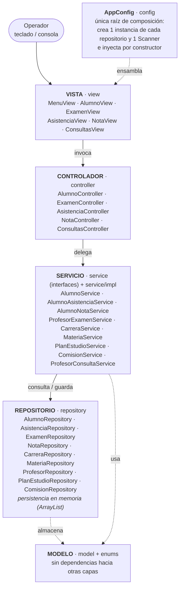

# 11 — Arquitectura

## Diagrama de capas

## Propósito

El diagrama muestra la separación en capas del sistema y la dirección de las dependencias.
Permite ubicar responsabilidades y verificar que la implementación respete esa separación.

- Los servicios son interfaz en `service/` con implementación en `service/impl/`.
- `AppConfig` es el único lugar que conoce todas las capas: crea repositorios, servicios, controladores y vistas.
- Los datos maestros (carreras, materias, profesores, planes y comisiones) se precargan al iniciar y son de solo lectura.
